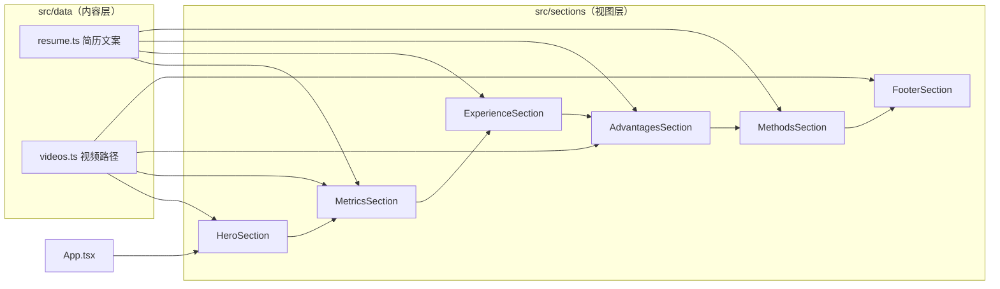

<div align="center">

# jianli-web

**刘东生的个人简历网站 · 维护文档**


</div>

> [!IMPORTANT]
> 这份文档写给**接手维护这个仓库的人或 AI 助手**。动手前请先读完「[内容修改速查](#-内容修改速查)」和「[已知陷阱](#️-已知陷阱)」。改完后按「[提交前自检](#-提交前自检)」检查一遍。

---

## 目录

- [快速开始](#-快速开始)
- [架构概览](#-架构概览)
- [文件职责](#-文件职责)
- [内容修改速查](#-内容修改速查)
- [常见任务操作步骤](#-常见任务操作步骤)
- [设计规范](#-设计规范)
- [代码约定](#-代码约定)
- [已知陷阱](#️-已知陷阱)
- [提交前自检](#-提交前自检)
- [提交与部署](#-提交与部署)
- [给 AI 助手的规则](#-给-ai-助手的规则)

---

## 🚀 快速开始

环境要求：Node.js 18+（已在 Node 25 上验证可以构建）。

```bash
npm ci            # 按 package-lock.json 安装依赖
npm run dev       # 开发服务器 http://localhost:5173
npm run build     # tsc -b 类型检查 + vite build，产物输出到 dist/
npm run preview   # 本地预览 dist/
```

> [!NOTE]
> 项目没有配置单元测试和 ESLint。**`npm run build` 能通过就是最低合格线**，因为它会在 strict 模式下做完整的 TypeScript 类型检查。

---

## 🧱 架构概览

纯前端的单页静态站，不用路由，不调后端接口，也没有全局状态库。页面就是 6 个区块从上到下排列：



| 顺序 | 组件 | DOM id | 背景 | 数据来源 |
| --- | --- | --- | --- | --- |
| 1 | [`HeroSection`](src/sections/HeroSection.tsx) | `hero` | `hero.mp4`（桌面端跟随鼠标拖动播放，移动端自动循环） | **组件内硬编码** |
| 2 | [`MetricsSection`](src/sections/MetricsSection.tsx) | `metrics` | `metrics.mp4` | `resume.ts → metrics` |
| 3 | [`ExperienceSection`](src/sections/ExperienceSection.tsx) | `experience` | 纯黑 + 光晕 | `resume.ts → experienceCards` |
| 4 | [`AdvantagesSection`](src/sections/AdvantagesSection.tsx) | `cinematic` | `cinematic.mp4` | `resume.ts → advantageLines` |
| 5 | [`MethodsSection`](src/sections/MethodsSection.tsx) | 无 | 纯黑 | `resume.ts → methods` + 组件内标题 |
| 6 | [`FooterSection`](src/sections/FooterSection.tsx) | 无 | `footer.mp4`（左半边） | **组件内硬编码** |

`App.tsx` 里只有一个状态 `entranceComplete`。Hero 挂载 800ms 后把它设为 `true`，触发首屏文字的入场动画。

---

## 📁 文件职责

```text
├── index.html                 # <title>、description、Open Graph 分享卡片
├── public/
│   ├── favicon.svg            # 黑底白字「刘」
│   └── videos/                # {hero,metrics,cinematic,footer}.mp4 + 同名 -poster.jpg
├── src/
│   ├── main.tsx               # 入口，StrictMode 挂载
│   ├── App.tsx                # 按顺序组合各区块
│   ├── index.css              # Tailwind 指令 + 全局样式 + 少量移动端覆盖
│   ├── components/
│   │   ├── ScrambleIn.tsx     # 乱码逐字显现（用于 Hero 姓名）
│   │   └── VideoBackground.tsx# 通用背景视频：静音 / 循环 / playsInline / aria-hidden
│   ├── data/
│   │   ├── resume.ts          # 简历文案的唯一数据源（含 ExperienceCard 类型定义）
│   │   └── videos.ts          # 视频与 poster 路径，带 ?v= 缓存版本号
│   └── sections/              # 每个区块一个文件，具名导出
├── tailwind.config.js         # 只扩展了 fontFamily（sans / mono）
└── .gitignore                 # 忽略 *.pdf 和 resume-extracted.txt：简历原件不进仓库
```

---

## 🔎 内容修改速查

**改文案先查这张表。** 大部分内容在 `resume.ts`，但有不少硬编码在组件里，而且同一信息可能出现在多处。

| 要改的内容 | 位置 | 备注 |
| --- | --- | --- |
| 工作经历 | `src/data/resume.ts` → `experienceCards` | 数组顺序就是显示顺序，**按时间倒序** |
| 核心数据（5年 / 30+ / 0→1） | `src/data/resume.ts` → `metrics` | ⚠️ **还要同步改** `MetricsSection.tsx` 的 `MetricValue`，见[陷阱 1](#️-已知陷阱) |
| 个人优势（4 行大字） | `src/data/resume.ts` → `advantageLines` | 桌面端每行强制不换行，单行不要太长 |
| 工作方法三张卡片 | `src/data/resume.ts` → `methods` | 格式 `[序号, 标题, 描述]`，桌面端三列，保持 3 项 |
| 工作方法区大标题 | `src/sections/MethodsSection.tsx` | 两个 `<span className="block">`，一行一句 |
| 首屏姓名 | `src/sections/HeroSection.tsx` → `<ScrambleIn text=…>` | 同时出现在 `index.html`、`FooterSection.tsx`、`favicon.svg` |
| 首屏副标题 | `src/sections/HeroSection.tsx` | `whitespace-nowrap`，变长后小屏会溢出 |
| 首屏三个 `#` 标签 | `src/sections/HeroSection.tsx` → 标签数组 | |
| 手机号 / 微信 | `src/sections/FooterSection.tsx` → `PHONE_DISPLAY` / `PHONE_RAW` | 两个都要改：一个用于显示，一个是复制出去的纯数字 |
| 页脚标语 | `src/sections/FooterSection.tsx` | 「把 AI 玩成运营生产力的实干派」 |
| AI 作品集链接 | `MethodsSection.tsx` **和** `FooterSection.tsx` | 两处都要改 |
| 版权年份 | `src/sections/FooterSection.tsx` | 写死的 `(c) 2026` |
| 网页标题 / 描述 / 分享卡片 | `index.html` | `og:image` 用的是线上绝对地址 |
| 背景视频 | `public/videos/` + `src/data/videos.ts` | 见[替换视频](#替换背景视频) |

---

## 🧩 常见任务操作步骤

### 新增一段工作经历

在 `experienceCards` 数组**最前面**加一项（倒序）：

```ts
{
  company: '公司全称',                 // 同时用作 React key，不能和别的经历重复
  role: '职位',
  period: '2025.07 — 至今',           // 用全角破折号「—」，两侧各一个空格
  highlights: [                        // 卡片上显示，固定 3 条，每条一句
    '……',
    '……',
    '……',
  ],
  details: [                           // 点击后弹窗里显示
    { kind: 'context', text: '驻场 / 外派等补充说明' },   // 可选，灰色小字
    { kind: 'heading', text: '项目组（起止时间）' },       // 可选，带青色竖条的小标题
    { kind: 'item',    text: '具体工作内容，尽量带数字结果。' }, // 自动编号 01、02…
  ],
},
```

- `item` 的编号会跳过 `heading` 和 `context` 连续计数，不用手写序号。
- 同一段经历里两条 `details` 的 `text` 不能完全相同，它也被用作 React key。
- 卡片最小高度按 3 条 `highlights` 设计。超过 3 条或单条太长，三张卡片的高度会对不齐。
- 目前桌面端是 `md:grid-cols-3`。**经历变成 4 段时**需要调整布局（比如改成 2×2 或横向滚动），不要直接塞进去。

### 修改核心数据

1. 改 `resume.ts` 里的 `metrics`。
2. 打开 `MetricsSection.tsx` 里的 `MetricValue`，它是**按具体字符串匹配**来做动画的：
   - `useState` 初始值：给新数值设一个起始显示值，比如 `'0年'`、`'0+'`；
   - `useEffect` 里：仿照现有分支加一个计数动画，或者直接删掉对应分支。
3. 本地滚动到这一屏，确认数字是从起始值动画到目标值的。

### 替换背景视频

1. 用同样的文件名覆盖 `public/videos/xxx.mp4` 和 `xxx-poster.jpg`（poster 取视频第一帧）。
2. 把 `src/data/videos.ts` 里**所有** `?v=` 改成当天日期 `YYYYMMDD`，否则浏览器和 CDN 会继续用旧文件。
3. 体积控制：4 段视频加起来目前约 3.6 MB，单段尽量不超过 2 MB。参考命令：

   ```bash
   # 背景视频：去音轨、H.264、moov 前置以便边下边播
   ffmpeg -i in.mp4 -an -c:v libx264 -crf 28 -preset slow -pix_fmt yuv420p -movflags +faststart out.mp4

   # hero.mp4 额外建议缩短关键帧间隔，否则桌面端鼠标拖动播放时会卡顿
   ffmpeg -i in.mp4 -an -c:v libx264 -crf 28 -g 12 -preset slow -pix_fmt yuv420p -movflags +faststart hero.mp4

   # 生成 poster
   ffmpeg -i out.mp4 -frames:v 1 -q:v 3 out-poster.jpg
   ```

4. 换了 `hero-poster.jpg` 的话，社交平台的分享卡片可能要过一段时间才会更新（`og:image` 指向它）。

### 新增一个区块

1. 在 `src/sections/` 新建 `XxxSection.tsx`，用具名导出 `export function XxxSection()`。
2. 文案放进 `src/data/resume.ts` 并写好类型，不要直接写在 JSX 里（Hero 和 Footer 是历史遗留）。
3. 在 `App.tsx` 里按位置插入。
4. 区块之间靠上下渐变羽化到纯黑来衔接。新区块要么用纯黑背景，要么像 `MetricsSection` 一样在顶部和底部加 `from-black` 渐变层。
5. 用到背景视频的话，先在 `videos.ts` 里登记，再用 `<VideoBackground>`。

---

## 🎨 设计规范

整体风格是**纯黑底、白色加透明度分层、细字重、电影感视频、克制的青紫光晕**。新增内容请沿用下面这些现有写法，不要另起一套。

**颜色**：只用黑、白，靠透明度区分层级。点缀色只用 `cyan-400/500` 和 `indigo-500`，而且只用在光晕和 hover 高光上。

| 层级 | 类名 |
| --- | --- |
| 主文字 / 标题 | `text-white` |
| 正文 | `text-white/80` |
| 次要说明 | `text-white/55` ~ `text-white/65` |
| 辅助信息、序号、提示 | `text-white/30` ~ `text-white/45` |
| 边框 | `border-white/10`，hover 时 `border-white/25` ~ `/40` |
| 卡片底色 | `bg-white/[0.02]`，hover 时 `bg-white/[0.04]` ~ `[0.05]` |

**字体**
- 标题统一 `font-light`，配负字距 `tracking-[-0.02em]` ~ `[-0.055em]`。
- 序号、英文标签、数字用 `font-mono`，小字号，正字距（如 `tracking-[0.12em]`）。
- 字号优先用 `text-[clamp(min,vw,max)]` 做流式缩放。

**卡片**
- `rounded-xl border border-white/10 bg-white/[0.02] backdrop-blur`。
- 顶部加一条 1px 渐变高光线：`bg-gradient-to-r from-transparent via-white/20 to-transparent`，hover 时 `via-cyan-400/40`。
- hover 时上浮 `-translate-y-0.5` ~ `-translate-y-1`。

**光晕**：`rounded-full bg-cyan-500/[0.04~0.1] blur-[130px~160px]` 的大圆，`pointer-events-none absolute`。

**动效**（Framer Motion）
- 缓动统一用 `ease: [0.215, 0.61, 0.355, 1]`（easeOutCubic）。
- 进入视野时用 `whileInView` + `viewport={{ once: true }}`，只播放一次。
- 常见入场：`opacity 0→1`、`y 20~30→0`，强调内容加 `filter: blur(8px)→blur(0)`。
- 列表逐项延迟 `index * 0.1 ~ 0.32` 秒。

**响应式**
- 移动端断点是 **≤ 639px**，对应 Tailwind 的 `sm`（640px）以下。JS 判断（`HeroSection`）和 `index.css` 里的 media query 都用 639，改的时候要一起改。
- 首屏用 `h-[100dvh] min-h-[100svh]`，底部留出 `env(safe-area-inset-bottom)`。
- 每次改版都要在 **375px 宽（手机）和 1440px 宽（桌面）**下各看一遍，历史提交里大部分修复都是移动端排版问题。

---

## 📐 代码约定

- **TypeScript strict**，不写 `any`。数据结构的类型和数据放在一起（如 `ExperienceCard`）。
- **内容和视图分开**：文案放在 `src/data/`，组件只负责渲染。
- **样式优先用 Tailwind 工具类**。`index.css` 只放全局重置，以及工具类实在写不出来的移动端覆盖（目前有 `.advantages-section`、`.methods-heading`）。
- **注释用中文**，写在 JSX 块上方，说明这块是干什么的，比如 `{/* 顶部与底部无缝羽化到纯黑 */}`。
- **可访问性**是硬性要求，现有代码都做到了，新增代码也要保持：
  - 所有 `<button>` 写 `type="button"`，只有图标或符号的按钮要写中文 `aria-label`；
  - 可聚焦元素加 `focus-visible:ring-2 focus-visible:ring-white/60`；
  - 装饰性的视频和光晕加 `aria-hidden` / `pointer-events-none`；
  - 外链用 `target="_blank" rel="noreferrer noopener"`。
- **依赖要克制**：运行时只依赖 `react`、`react-dom`、`framer-motion`。不要为了一个小效果引入组件库或动画库。

---

## ⚠️ 已知陷阱

1. **`MetricValue` 写死了数值**：动画分支和初始值都是按 `'5年'`、`'30+'`、`'0→1'` 匹配的。只改 `resume.ts` 的话，新数值会先显示成 `0年`，再直接跳到目标值，没有计数动画。
2. **视频缓存**：替换视频不升级 `?v=` 版本号，线上会一直播放旧视频。
3. **同一信息在多处**：姓名在 4 处、作品集链接在 2 处、手机号有 2 个常量，改的时候要用全局搜索确认都改到了。
4. **Hero 拖动播放依赖关键帧密度**：`hero.mp4` 的关键帧间隔太大时，桌面端左右移动鼠标会一卡一卡的。
5. **弹窗退出动画不生效**：经历弹窗虽然写了 `exit` 属性，但外层没有包 `AnimatePresence`，所以关闭时会直接消失。要加退出动画，需要用 `<AnimatePresence>` 包住 `{selectedExperience && …}`。
6. **减少动态效果只管了 CSS**：`index.css` 里的 `prefers-reduced-motion` 只影响 CSS 动画和过渡，**Framer Motion 动画和视频自动播放不受影响**。
7. **id 和组件名对不上**：`AdvantagesSection` 的 DOM id 是 `cinematic`，这是历史命名。首屏的「SCROLL」按钮会跳到 `#metrics`，改 id 时要一起改。
8. **`package.json` 的 `name` 是 `synapsex-landing`**：这是初始化模板留下来的，没有实际影响。
9. **不要提交简历原件**：`.gitignore` 已经排除了 `*.pdf` 和 `resume-extracted.txt`，不要用 `git add -f` 强行加进来。

---

## ✅ 提交前自检

- [ ] `npm run build` 通过，没有类型错误
- [ ] 在 375px 宽下检查：没有横向滚动条，标题和标签没有溢出或意外换行
- [ ] 在 1440px 宽下检查：三列卡片高度对齐，优势区每行没有被截断
- [ ] 改过的区块入场动画正常，经历弹窗可以打开，`Esc` 能关闭
- [ ] 改了视频的话，已经升级 `videos.ts` 的版本号，体积也合理
- [ ] 改了姓名、链接或联系方式的话，已经全局搜索确认所有位置都改到了
- [ ] 结构、约定或陷阱有变化的话，**同步更新本 README**

---

## 📦 提交与部署

**提交信息**：用中文，一句话概括这次改了什么。多项改动用顿号分隔，有量化结果就写上数字。可以参考历史提交：

```text
压缩四段背景视频：36.6MB降至3.6MB，升缓存版本号
新增AI项目作品集入口：方法区尾部文字链+页脚按钮
页脚一键复制与分享标签、经历倒序、方法区三列、优势区去透视、收紧经历区留白
```

**分支**：直接在 `main` 上开发和提交。

**部署**：`npm run build` 生成的 `dist/` 是纯静态文件，线上域名是 `www.liutongxue.com.cn`。

| 项目 | 说明 |
| --- | --- |
| 托管平台 | _待补充_ |
| 触发方式 | _待补充（推送 main 后自动部署 / 手动上传 dist）_ |
| 构建命令 | `npm run build` |
| 输出目录 | `dist` |

---

## 🤖 给 AI 助手的规则

如果你是被要求修改这个仓库的 AI 助手：

1. **先读这份 README**，再读要改的文件。按「内容修改速查」找到所有相关位置。
2. **不要擅自改写简历文案**。措辞、数字、公司名都是真实信息，只按用户的明确要求修改。
3. **按现有设计规范来写**，不要引入新的颜色、字体、圆角体系，也不要换 UI 库。
4. **改动范围尽量小**。用户没要求的话，不要顺手重构、重命名或格式化无关代码。
5. **改完运行 `npm run build`**，并告诉用户需要在手机宽度下人工确认哪些地方。
6. **改了结构、约定或踩到新坑**，同步更新本 README 的对应章节。
7. 提交信息遵循上面的中文风格。

---

<sub>仓库暂无开源许可证。简历内容、个人信息和视频素材归作者所有。</sub>
